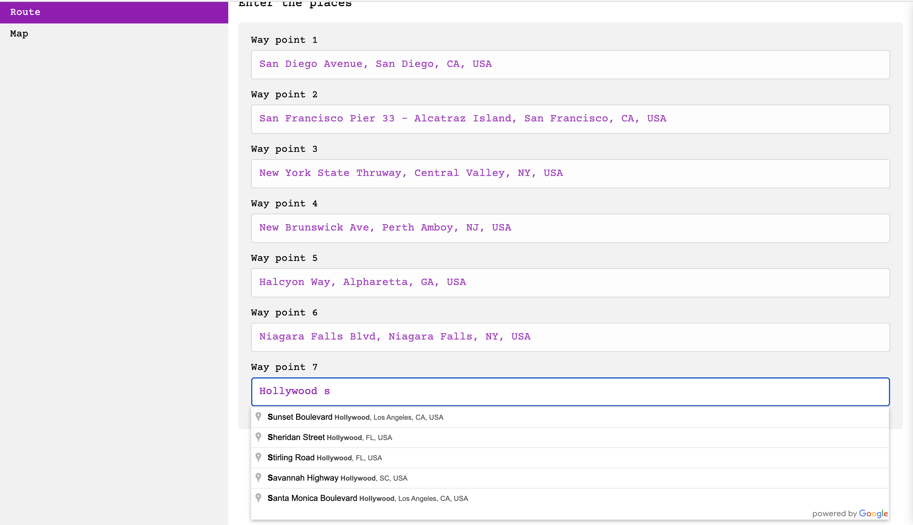
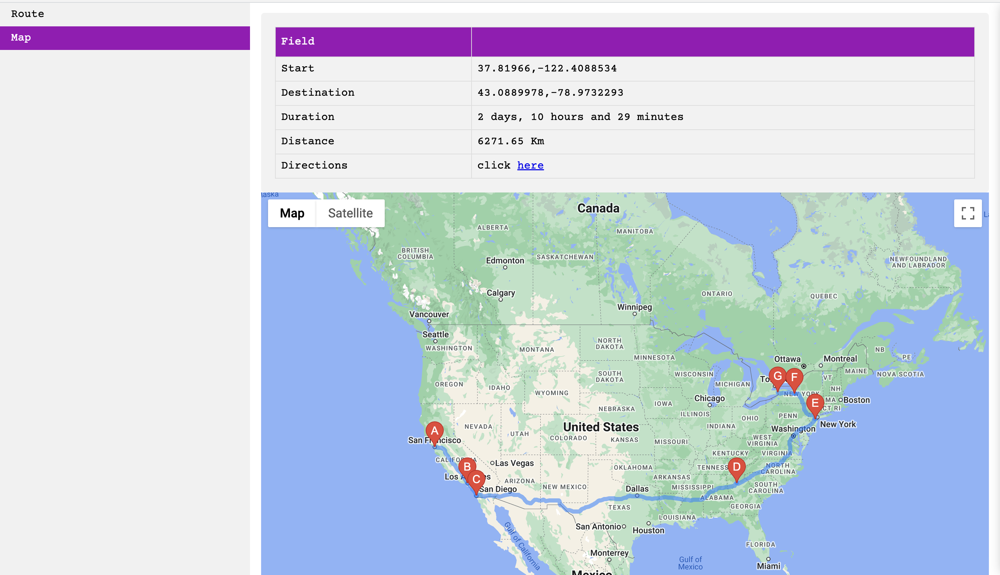

# 🗺️ Route Optimizer: Solving the Travelling Salesman Problem with Google Maps

> A Django web app that finds the shortest driving route through 7 places. You pick the stops with Google Places autocomplete, the app gets real road distances from the Distance Matrix API, finds the best visiting order with a bitmask dynamic-programming solver, and draws the route on Google Maps with turn-by-turn directions.


---

## Table of Contents

- [Demo](#demo)
- [Features](#features)
- [How It Works](#how-it-works)
- [The Algorithm](#the-algorithm)
- [Tech Stack](#tech-stack)
- [Getting Started](#getting-started)
- [Project Structure](#project-structure)
- [Limitations](#limitations)
- [Roadmap](#roadmap)
- [License](#license)

---

## Demo

**1. Enter 7 places with Google Places autocomplete**



**2. Get the best order, the total distance and time, and the route on a map**



*Example: 7 stops across the US (San Francisco, Los Angeles, San Diego, Georgia, New Jersey, New York and Niagara Falls) put into the best order. The result is 6,271 km and about 2 days 10 hours of driving.*

---

## Features

- **📍 Place search.** Every stop has Google Places autocomplete, so you can type an address, landmark or business.
- **🛣️ Real road distances.** Distances between stops come from the Google Distance Matrix API (driving mode), not straight lines.
- **🧠 Exact solution.** Bitmask dynamic programming checks every possible order and returns the provably shortest one.
- **🧭 Best starting point.** The solver tries all 7 stops as the start and keeps the shortest overall route.
- **🗺️ Map and directions.** The route is drawn on Google Maps with lettered markers (A to G), plus total distance, total drive time and step-by-step directions for each leg.

---

## How It Works

```
 Route page: 7 inputs with Google Places Autocomplete
            │  latitude and longitude of each place
            ▼
 /map?lat_a=..&long_a=..  …  lat_g=..&long_g=..
            │
            ▼
 Distance Matrix API ─► 7×7 matrix of driving distances (metres)
            │
            ▼
 Bitmask DP solver ─► try all 7 starts ─► shortest order of stops
            │
            ▼
 Directions API (origin, 5 waypoints, destination, in the optimized order)
            │
            ▼
 Map page: route on the map, lettered markers, total km and time,
           step-by-step directions for each leg
```

---

## The Algorithm

The heart of the app is the `Solution` class in `did_django_google_api_tutorial/mixins.py`, a top-down **Held–Karp** style dynamic program.

**State.** `dp[mask][pos]` is the shortest distance to visit every place *not yet in* `mask`, starting from place `pos`.
- `mask` is a 7-bit number. Bit *i* is set if place *i* has already been visited.
- Once all bits are set (`mask == 2ⁿ − 1`), the remaining cost is 0.

**Step.**

```
dp[mask][pos] = min over unvisited j of ( dist[pos][j] + dp[mask | (1 << j)][j] )
```

**Rebuilding the route.** Alongside each `dp` value, `path_dp[(mask, pos)]` stores the best order of stops from that state, so the final route can be read off directly.

**Choosing the start.** The solver runs once per possible starting place, `tsp(1 << i, i)` for i = 0 to 6, and keeps the overall minimum.

| | Brute force | Bitmask DP |
|---|---|---|
| Time | O(n!) | **O(2ⁿ · n²)** |
| Orders checked for n = 7 | 5,040 per start | 896 states × 7 choices |
| Memory | O(n) | O(2ⁿ · n) |

> **Note:** this finds the shortest **one-way route** through all stops (a Hamiltonian path). It doesn't return to the starting point. To get the classic round trip, add `dist[pos][start]` when `mask` is full.

---

## Tech Stack

| Area | Tools |
|---|---|
| Backend | Python, Django |
| Algorithm | Bitmask dynamic programming (Held–Karp) |
| Google APIs | Places (autocomplete), Distance Matrix, Directions, Maps JavaScript, Geocoding |
| Libraries | `googlemaps`, `requests`, `humanfriendly` |
| Frontend | Django templates, vanilla JavaScript, CSS |

---

## Getting Started

### 1. Get a Google Maps API key

In the [Google Cloud Console](https://console.cloud.google.com/google/maps-apis), create an API key and **turn on**:

- Places API
- Maps JavaScript API
- Directions API
- Distance Matrix API
- Geocoding API

> Google Maps Platform requires a billing account, but small personal projects usually fit inside the free monthly credit.

### 2. Install

```bash
git clone <your-repo-url> tsp-route-optimizer
cd tsp-route-optimizer

python3 -m venv venv
source venv/bin/activate          # Windows: venv\Scripts\activate
pip install django googlemaps requests humanfriendly
```

> `requirements.txt` combines two different environments and pins conflicting versions, so installing the four packages above is the reliable option.

### 3. Configure

In `did_django_google_api_tutorial/settings.py`, set:

```python
GOOGLE_API_KEY = "your-api-key"
```

### 4. Run

```bash
python manage.py migrate
python manage.py runserver
```

Open **http://localhost:8000**, enter 7 places and submit.

---

## Project Structure

```
tsp-route-optimizer/
├── manage.py
├── did_django_google_api_tutorial/
│   ├── settings.py            # Django settings and GOOGLE_API_KEY
│   ├── urls.py
│   └── mixins.py              # TSP solver, distance matrix and Directions helpers
├── main/
│   ├── views.py               # Route page (input) and map page (results)
│   └── urls.py                # "/" route page, "/map" map page
├── templates/
│   ├── base.html
│   ├── partials/nav.html
│   └── main/
│       ├── route.html         # 7 autocomplete inputs
│       └── map.html           # Map, summary table and directions
├── static/
│   ├── google_places.js       # Places Autocomplete setup
│   ├── google_maps.js         # Map and route drawing
│   └── main.css
├── Place.png                  # Screenshot: entering stops
└── Output.png                 # Screenshot: optimized route
```

---

## Limitations

- **Exactly 7 stops.** The view and templates are written for exactly 7 places.
- **49 API requests per run.** The distance matrix is built one pair at a time, including each place to itself. One batched Distance Matrix request would be faster and cheaper.
- **One-way route, not a round trip.** See the note under [The Algorithm](#the-algorithm).
- **Doesn't scale to large n.** At O(2ⁿ · n²), the exact solver is practical up to about 15–20 stops. Larger inputs would need heuristics such as nearest-neighbour, 2-opt or OR-Tools.

---

## Roadmap

- [ ] Any number of stops (2–15) with dynamic form fields
- [ ] One batched Distance Matrix request
- [ ] Round-trip option and a fixed starting point
- [ ] Choose between optimizing for distance and for time
- [ ] Compare against Google's `optimize:true` waypoint ordering
- [ ] Load the API key from environment variables
- [ ] Heuristic solvers for large inputs

---

## License

Released under the [GNU General Public License v3.0](LICENSE). The Django and Google Maps integration builds on the Django + Google Maps API tutorial structure. The route optimization (distance matrix and bitmask DP solver) was added on top.